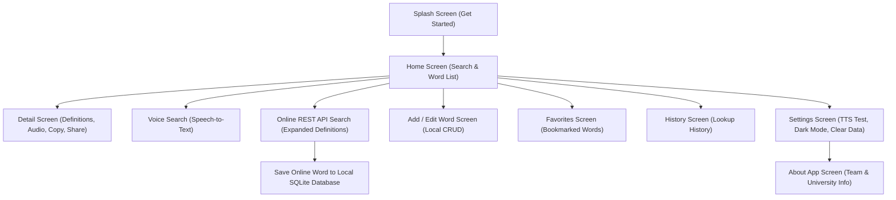

# Project Proposal & Specification Document
## Smart Dictionary: Offline-First Hybrid English–Khmer Mobile Application

---

### 1. Academic & Course Context
- **Institution**: National University of Battambang (NUBB)
- **Academic Year / Semester**: Year 4, Semester 1
- **Course**: Mobile Application Development Using Flutter and Dart
- **Lecturer / Evaluator**: Mr. Ang Sophea (`angsophea@gmail.com`)
- **Project Duration**: 4–5 Weeks
- **Target Platform**: Android (Cross-platform Flutter)

---

### 2. Team Member Information & Role Distribution

To ensure effective collaboration and clear accountability (as required by Section 7 of the course guidelines), project responsibilities are distributed across our 6-member team:

| No. | Member Name | GitHub / Contact | Assigned Role & Responsibilities |
| :---: | :--- | :--- | :--- |
| **1** | **Hor Tola** | [`@tola-12`](https://github.com/tola-12) `hortola780@gmail.com` | **Project Leader & State Management Architecture** • Project coordination, timeline management, and code reviews. • Implementation of reactive state management using GetX (`MyData` controller). • Git repository maintenance, branch management, and release builds. |
| **2** | **Oum On** | [`@oumon9722-ops`](https://github.com/oumon9722-ops) `oumon9722@gmail.com` | **Database Architecture & Local Storage (SQLite)** • Database schema design, asset pre-population (36,000+ words). • Implementation of SQLite CRUD helper methods (`DBHelper`). • Permanent data persistence for Bookmarks/Favorites and Search History. |
| **3** | **Ouch Rothphanith** | `ouchsophanith99@gmail.com` | **UI/UX Design & Theming** • Screen design, color palette, typography, and card layouts. • Dynamic Light Mode and Dark Mode theme configuration. • Responsive styling across various Android display densities. |
| **4** | **Chetra SreyPhim** | `chitrasreyphim045@gmail.com` | **Screen Development & Navigation Flow** • Development of core UI screens: Splash, Home, and Settings. • Navigation architecture, route definitions, and bottom navigation bar flow. • Input form validation and error/success snackbar messaging. |
| **5** | **Voeurn Sothearoth** | `voeunsothearoth1212@gmail.com` | **REST API Integration & Networking** • Integration of external REST API (Free Dictionary API) using `http`. • Asynchronous network communication, JSON serialization/deserialization. • Handling loading spinners, connection timeout states, and network errors. |
| **6** | **Nil Mengieng** | `jralbert725@gmail.com` | **Media Services, Testing & Documentation** • Integration of Text-To-Speech (`flutter_tts`) and Speech-To-Text (`speech_to_text`). • Detail screen interactive actions (Copy to clipboard, Share Plus intent). • Quality assurance testing, bug tracking, and final project documentation. |

---

### 3. Background & Problem Statement

#### The Context:
In Cambodia, English proficiency is a vital gateway to higher education, scholarships, IT careers, and regional business opportunities. Every day, thousands of high school and university students consult dictionaries to decipher academic papers, technical documentation, and foreign literature.

#### The Problem:
1. **Unstable & Costly Internet Connectivity**: Many existing dictionary apps rely heavily on continuous internet access. For students in rural provinces, dormitories, or on cellular data plans, offline connectivity is crucial. If the connection drops, traditional online tools fail.
2. **Pronunciation & Phonetic Difficulties**: Khmer native speakers often struggle with English pronunciation, stress, and silent letters. Most offline dictionaries provide only text translations without clear phonetic transcriptions or native audio pronunciations.
3. **Rigid, Outdated Word Databases**: Language constantly evolves with new colloquialisms, academic terms, and technical jargon. Most pre-packaged mobile dictionaries are read-only and prevent learners from adding new words or editing definitions.
4. **Fragmented Learning Tools**: Learners are often forced to use separate apps for translation, text-to-speech, flashcards, and search history, resulting in a disconnected user experience.

---

### 4. Project Objectives

#### General Objective:
To design and develop a robust, modern, and user-centric English–Khmer hybrid dictionary application utilizing **Flutter**, **Dart**, **SQLite**, and **REST API**, solving the connectivity gap while delivering rich linguistic resources for Cambodian students and professionals.

#### Specific Objectives:
1. **Offline Accessibility**: Package a high-performance local SQLite database containing over **36,000 words** with English IPA phonetics, Khmer phonetics, and HTML definitions accessible 100% offline.
2. **Intelligent Search**: Provide real-time ranked search results with instant prioritization (Exact match > Prefix match > Contains match).
3. **Multimodal Interaction**: Implement **Text-to-Speech (TTS)** audio pronunciation and **Speech-to-Text (STT)** voice recognition for hands-free lookup.
4. **REST API Hybrid Augmentation**: Integrate an external REST API (Free Dictionary API) via HTTP to fetch live expanded definitions, synonyms, antonyms, and usage examples, allowing users to save online results directly to their local SQLite database.
5. **Full CRUD Capability**: Allow users to Create, Read, Update, and Delete custom vocabulary, personalized bookmarks, and search history.
6. **Modern UI & Accessibility**: Provide a clean Material Design interface with instant toggling between **Light Mode** and **Dark Mode** to reduce eye strain during nighttime study.

---

### 5. Target Users & Beneficiaries

1. **University & High School Students**: Primary target audience who require rapid, reliable translations for coursework, exams, and thesis research without relying on mobile data.
2. **Rural Learners & Low-Bandwidth Users**: Students in areas with intermittent or slow mobile network coverage who benefit from the 100% offline SQLite foundation.
3. **Translators & Content Creators**: Professionals needing quick phonetic references and rich definitions for accurate language transposition.
4. **Language Instructors & Teachers**: Educators who can demonstrate pronunciation and encourage students to maintain personalized vocabulary lists.
5. **English Beginners & Self-Learners**: Beginners benefiting from dual phonetic systems (standard international IPA alongside Khmer phonetic transliteration: e.g., `book` ➔ `bʊk` ➔ `ប៊ុកខ៍`).

---

### 6. Development Approach (Option A: REST API + Local Database)

In accordance with **Section 3 (Option A)** of the course specifications:
- **Local Storage Layer**: **SQLite** (`sqflite` & `path`)
  - `words` table: 36,334 preloaded entries.
  - `favorites` table: Persistent saved bookmarks.
  - `history` table: Persistent recent search history.
- **Network / API Layer**: **REST API** (`http`)
  - Integration with the Free Dictionary REST API (`https://api.dictionaryapi.dev/api/v2/entries/en/{word}`).
  - Asynchronous data fetching, JSON parsing, error boundaries (No Internet / 404 Not Found), and loading state indicators.
- **State Management**: **GetX Architecture**
  - Centralized reactive controller (`MyData`) managing live search filters, persistent lists, and dynamic theming without unnecessary rebuilds.
- **Presentation & Navigation**:
  - Flutter Material 3 widgets with custom theme data and persistent bottom navigation routing.

---

### 7. Main Application Features & Workflow

1. **Splash & Onboarding**: Clean introductory screen branding the application.
2. **Instant Search & Autocomplete**: Real-time filtering through 36,000+ words with custom relevance ranking.
3. **Voice Search**: Hands-free voice recognition input using device microphone.
4. **Rich Word Details**:
   - English word and Part of Speech.
   - Dual Phonetics (English IPA + Khmer phonetic approximation).
   - Rich Khmer definition with HTML formatting.
   - Text-to-Speech audio playback.
   - One-tap copy to clipboard and system share.
5. **Online Augmentation (REST API)**: Live fetching of extended definitions, synonyms, antonyms, and web audio.
6. **Vocabulary Management (CRUD)**: Insert new custom entries or update existing definitions with instant UI reflection.
7. **Personalized Bookmarks & History**: SQLite-persisted lists with individual item deletion and batch clearing.
8. **Dark Mode & Theming**: System and user-selectable dark themes across all 8 application screens.

---

### 8. Expected Impact & Evaluation

| Evaluation Criteria (100 Marks) | How Our Project Satisfies the Requirement | Marks |
| :--- | :--- | :---: |
| **Project Proposal** | Clear objectives, problem statement, team roles, and target audience. | 5 |
| **UI/UX Design** | Intuitive 8-screen flow, accessible typography, responsive cards, light/dark themes. | 10 |
| **Dart & Flutter Implementation** | Clean code formatting, strong typing, zero compilation warnings, modular widgets. | 15 |
| **Navigation & Functionality** | Leak-free bottom navigation, audio playback, speech recognition, clipboard integration. | 10 |
| **Architecture & State Management** | Reactive GetX controller, separation of UI and business logic. | 10 |
| **REST API Integration** | HTTP communication with Free Dictionary API, loading states, network error handling. | 15 |
| **Database Implementation** | SQLite database with 36k preloaded rows, relational CRUD, schema persistence. | 15 |
| **Testing & Error Handling** | Network boundary safety, try/catch handlers, graceful user notifications. | 5 |
| **Documentation** | GitHub README, API references, architecture diagrams, and submission reports. | 5 |
| **Presentation & Demonstration** | Video walkthrough and live demo showcasing offline + online workflows. | 10 |
| **Total** | | **100** |
